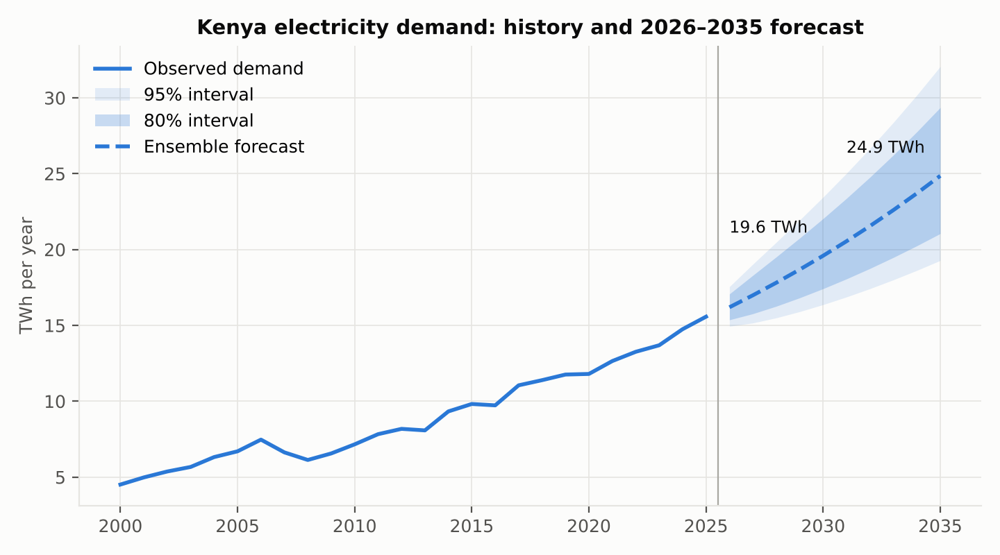
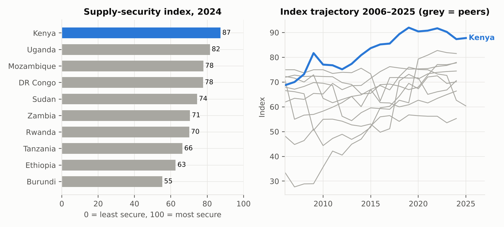
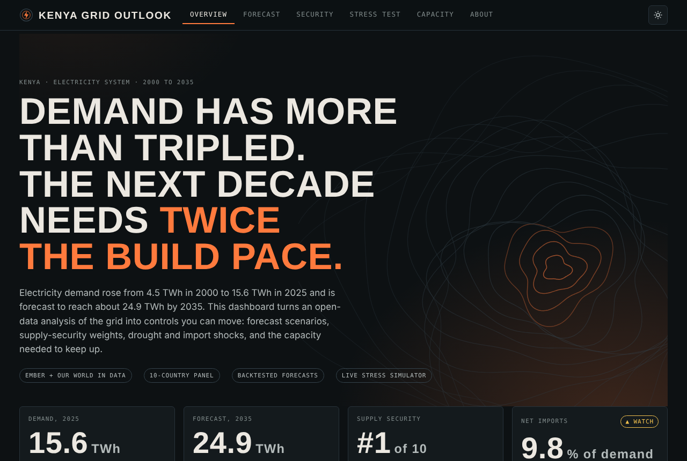

# Kenya Electricity Demand Outlook & Supply-Security Assessment

Forecasting demand, measuring supply security, stress-testing the grid and sizing the capacity gap, **2000–2035**, using open data for Kenya and nine regional peers.

> Built as an applied-economics portfolio project. Every number in the reports is generated by the code in this repository from public datasets; the whole pipeline reruns in about 10 seconds.



## What this project answers

| Question | Method | Where |
|---|---|---|
| How fast will electricity demand grow to 2035? | Five forecasting models, 42 rolling-origin backtests per model, calibrated 80%/95% intervals | Report ch. 4 |
| How secure is Kenya's supply vs. its neighbours? | Four-pillar supply-security index (10 countries, 2006–2025) with 10,000 random-weight robustness test | Report ch. 5 |
| What if drought or an import outage hits? | Deterministic scenarios + 20,000-draw Monte Carlo on observed hydrology | Report ch. 6 |
| How much new generation is needed? | Capacity-gap analysis under three demand paths and three technology mixes | Report ch. 7 |

## Headline results

- Demand grew from 4.5 TWh (2000) to **15.6 TWh (2025)**, 5.1% a year. Central forecast: **19.6 TWh in 2030** and **24.9 TWh in 2035** (80% interval 21.0–29.4).
- Backtested ensemble error: 2.9% (1 year ahead), 3.9% (2 years), 3.3% (3 years). Simple trend models beat damped-trend ETS.
- Kenya ranks **#1 of 10** on the supply-security index in 2024 (diversified mix); median rank 1 under random weights, first in 54% of 10,000 draws.
- The deteriorating pillar is **import dependence**: 0.1% of demand in 2015 vs **9.8%** in 2025.
- Stress test (annual-energy basis): thermal plant covers a 2000-type drought *or* a total import loss alone; both together leave **5.8%** of demand unserved. Monte Carlo shortfall probability: 0% with imports available, **27%** with imports out.
- Base-case demand needs **2.2x** the 2015–2025 pace of new supply: about 2.2–3.1 GW of new capacity by 2035 depending on the technology mix.



## Interactive dashboard

Open `index.html` in any browser. It is a single self-contained file with no server and no Power BI: a themed control-room dashboard with live controls for forecast scenarios, supply-security weights, a drought and import-loss stress simulator, and a capacity-gap calculator.

**Explore the interactive dashboard here:** [Kenya Electricity Outlook Live Dashboard](https://samolart.github.io/kenya-electricity-outlook/#overview)



## Reports

| Document | Description |
|---|---|
| [`reports/Final_Report_Kenya_Electricity_Outlook_and_Supply_Security.pdf`](reports/Final_Report_Kenya_Electricity_Outlook_and_Supply_Security.pdf) | 25-page analytical report: findings, recommendations, limitations |
| [`reports/Technical_Methods_Report.pdf`](reports/Technical_Methods_Report.pdf) | Methods, formulas, parameters, assumptions register, decision log, full code |


## Data

| File | Source | Licence |
|---|---|---|
| `data/raw/ember_generation_yearly.csv` | [Ember yearly electricity data](https://ember-energy.org/data/yearly-electricity-data/) | CC BY 4.0 |
| `data/raw/owid-energy-data.csv` | [Our World in Data energy dataset](https://github.com/owid/energy-data) | CC BY 4.0 |

Raw files are unmodified downloads. Processed tables are in `data/processed/`. See [`docs/data_dictionary.md`](docs/data_dictionary.md).

## Run it

```bash
python3 -m pip install -r requirements.txt
bash run_all.sh            # rebuilds data, tables, figures and both reports
```

Scripts are run with `python3 -I` from the repository root. No external API access is needed; time-series models are implemented from scratch with numpy/scipy.

```
src/01_build_dataset.py              harmonise Ember + OWID into Kenya and regional panels, quality checks
src/02_forecast_models.py            models, rolling-origin backtests, intervals, elasticities
src/03_security_stress_scenarios.py  security index, stress tests, Monte Carlo, capacity gap
src/04_figures.py                    figures
src/05_build_final_report.py         final report (DOCX)
src/06_build_technical_report.py     technical report (DOCX)
src/07_build_dashboard.py            interactive dashboard (writes index.html)
src/dashboard_template.html          dashboard markup, styles and chart code
```

## Limitations (short version)

Annual data only (26 observations for Kenya); energy balance, not peak power; no price or cost data; thermal availability and new-plant capacity factors are assumptions with sensitivity tests; the ensemble members were chosen after a first backtest (mild optimism); Ember reports no geothermal capacity for Kenya. The full list is in Chapter 9 of the final report.

## Licence

Code: MIT (see `LICENSE`). Data: CC BY 4.0 from the original providers; please cite Ember and Our World in Data when reusing.

## Author

Samatar Ahmed
